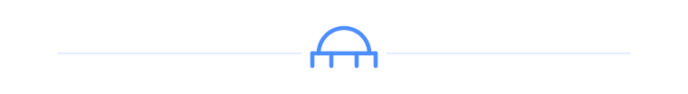
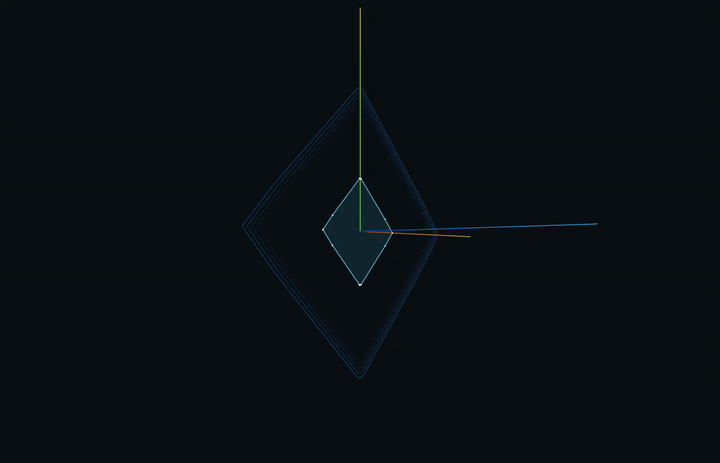

# Diff Games Lab

*A research playground for differential games — stable bridges, the methods that compute them, and the strategies they yield.*




**Track 1 of the lab is running here:** the maximal stable bridge of a linear differential game,
in support-function form. The rest of this page describes that track — its theory, its engine,
its five examples and its viewer.

Given `ẋ = A x + B u + C v` with compact convex control sets `P` and `Q`, a polyhedral target
`π x(T) ∈ M`, and a partition of `[0,T]`, the solver prints the alternating-sum approximations
`W^k` of the bridge as a sequence of polyhedral shells. Convex sets are never carried as vertex
lists: they are 110 support values over a fixed direction grid, and the geometric difference is
performed entirely in dual space.

## Research tracks

The bench is a set of tracks over one game format; each track is a method plus its evidence and
its way of looking at the answer. Only the first is built out.

| track | question | state |
|---|---|---|
| **1. Linear bridges, support functions** | the maximal stable bridge of `ẋ = Ax + Bu + Cv`, carried as support values over 110 directions | implemented — this repository |
| **2. Non-linear games** | which of those steps survive when `ẋ = f(x, u, v)` | case, grid reference, and a measured step wall; no engine code |
| **3. Alternative constructions** | the same bridge by other means, and whether the answers agree | planned |
| **4. Winning strategies** | realising the bridge as a positional strategy, and testing it | certificate built — `--certify`, two of five cases fail |
| **5. Unstable parameters** | the same bridge when the drift is known only up to `ΔA` | planned |
| **6. Method evolution** | direction error, adaptive refinement, support-function error, a guaranteed inclusion check | measured instruments — bands, covering radius, alignment; no engine direction-error code |
| **7. Games and learning** | a network that reproduces the bridge fast, with an exact check that may refuse it | planned |

[`kb/RESEARCH.md`](kb/RESEARCH.md) states what each track owes, the conventions that keep them
comparable, and the open questions; its [references](kb/RESEARCH.md#references) collect the theory,
uncertain-dynamics, application and learning context the tracks are read against.

[`kb/`](kb/README.md) is the lab's memory: one proposal per track with its expected outcomes and
how they would be read, and one file per finding, so a later session can pick up a track without
the conversation that started it.

## Layout

| | part | what it is |
|:--:|---|---|
|  | `docs/` | track 1's method, chapter by chapter |
|  | `engine/` | track 1's solver (Rust, no dependencies) |
|  | `examples/` | five problems with known answers, and their outputs |
|  | `viewer/` | three.js page that draws any output file |
|  | `kb/` | the lab's memory: proposals per track, one finding per file |
|  | `assets/` | the clip above and the icons this page uses |

## Requirements

- Rust (stable) for `engine/`; the solver has no crate dependencies.
- Python 3.11+ with `numpy` for `tools/`; these are the measurement scripts, not part of the build.
- Node 18+ only to rebuild or test the viewer. The page ships prebuilt in `viewer/dist/app.js`.

## Quick start

```sh
cd engine
cargo build --release

./target/release/stable_bridge ../examples/example-1.txt target/example-1.txt
./target/release/stable_bridge ../examples/example-2a.txt target/example-2a.txt
```

With no arguments the program reads `problem.txt` and writes `out.txt`. The input grammar and
the output document are documented in [`engine/README.md`](engine/README.md).

To look at a run, serve the repository and open the viewer:

```sh
python -m http.server 8000
# http://localhost:8000/viewer/?src=../examples/out/example-1.out.txt
```

The dropdown loads any of the five examples without a file dialog, dropping your own output on
the page still works, and **record** saves the canvas — every camera move included — as MP4
where the browser can mux it and WebM otherwise. The clip at the top of this page is one take.

The viewer can also start a run. Start the engine server, then drop a problem file on the page
or pick one under *compute from a problem*; the bar under the selector reads the run's finished
blocks, and **invalidate cache** clears that case before recomputing.

```sh
cd engine
cargo run --release --bin bridge_server
```

## How track 1 works

| Chapter | What it establishes |
|---|---|
| [The game and the stable bridge](docs/01-game-and-bridge.md) | dynamics, strategies, the stability property, and the reverse-time transform that fixes the terminal instant |
| [Convex sets through their support functions](docs/02-support-functions.md) | support functions, Minkowski sum, geometric difference, and the `co` reconstruction that makes a direction grid usable |
| [Discretization](docs/03-discretization.md) | the partition, the interval map `A_k`, the recurrence `W^k = (W^{k−1} ⊖ Q_k) ⊕ P_k`, the capture test |
| [The algorithm as implemented](docs/04-algorithm.md) | the 110 directions, vertex enumeration, the dual update stage by stage, constants, module map |
| [The time step: interval map and refinement](docs/05-time-step.md) | how a step splits into 110 pieces, why that is the right refinement, where the error goes |
| [Results](docs/06-results.md) | the five examples, measured extents, mesh consistency, the grid's accuracy floor |
| [Falsifications](docs/07-falsifications.md) | the predictions that missed, and what each one changed |

Start at [`docs/README.md`](docs/README.md) for notation and the reading order.

## What it computes

Last-block extents of the five tracked runs:

| case | control sizes | blocks | vertices | extent |
|---|---|---|---|---|
| 1, diamonds | `α = 2` vs `β = 1` | 20 | 498 | x ±3.000, y ±2.931 |
| 2a, squares | `α = 2, β = 1` | 8 | 504 | x ±0.980, y ±0.926 |
| 2b, squares | `α = 2, β = 2` | 8 | 168 | x ±0.500, y ±0.514 |
| 2c, squares | `α = 1, β = 2` | 8 | 333 | x −0.030…0.026, y ±0.100 |
| 3d, cubes | `α = 2` vs `β = 1` | 4 | 186 | x ±1.500, y ±1.500, z ±1.987 |

The pattern is the game's: equal control authority cancels in the recurrence, so the bridge is
the target for all time; more authority for the first player grows it, less shrinks it. The
outputs in [`examples/out/`](examples/out) are committed and regenerated byte for byte by the
command in [`examples/README.md`](examples/README.md).

## Accuracy

Three approximations act at once, and only one of them is controlled by the time step:

* **direction grid** — 110 samples. Up to 1.6° off in 2D, 18° off at the poles in 3D, which is
  why a 3D shell is not capped along `z` (see `example-3d`). This is the floor.
* **interval refinement** — 110 sub-steps per block, second order in the step.
* **tolerances** — `1e-5` for the matrix series, `0.01` for vertex de-duplication and half-space
  acceptance. Both are constants of the method and are documented in
  [`engine/README.md`](engine/README.md).

Refining `Step` at fixed `T` leaves the final set unchanged, which is the mesh consistency an
alternating sum needs; the test suite asserts it.

## Tests

-  `cargo test` — formats, pipeline, examples
-  `npm test` — the viewer's parser and geometry

```sh
cd engine && cargo test
cd viewer && npm install && npm test
```

The viewer needs Node 18+ for its test runner and bundler; the page itself ships prebuilt in
`viewer/dist/app.js` and runs without either.
